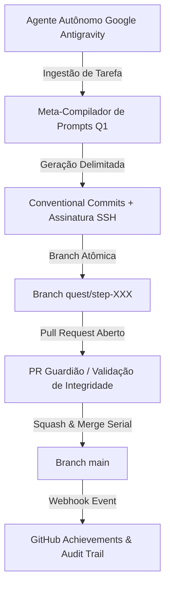

# 🦈 Pull Shark Gold Quest & Autonomous CI/CD Matrix

<div align="center">

[](https://github.com/q1-by-taco)
[](docs/AUTONOMOUS_CI_CD_BENCHMARK_REPORT.md)
[-FFD700?style=for-the-badge&logo=github)](https://github.com/q1-by-taco/pull-shark-quest/pulls?q=is%3Apr+is%3Amerged)
[](https://github.com/q1-by-taco/pull-shark-quest/commits/main)
[](https://github.com/kreftamarcio)
[](https://github.com/q1-by-taco/pull-shark-quest/discussions/categories/show-and-tell)

<p align="center">
  <b>Matriz autônoma de engenharia de software e benchmarking de CI/CD para conquista e validação do Pull Shark de Ouro (128 PRs atômicos com assinaturas criptográficas Ed25519).</b>
</p>

</div>

---

## 🏛️ Destaques da Comunidade (Show and Tell)

Confira os artigos e blueprints técnicos detalhados publicados na aba de Discussões:

* 🚀 **[Showcase: Q1 Autonomous CI/CD Matrix (128 Verified PRs & Evidence-First Architecture)](https://github.com/q1-by-taco/pull-shark-quest/discussions/134)**  
  *Análise aprofundada da esteira serial de branches, conformidade anti-abuso do GitHub e auditoria de contratos.*
* 🧠 **[Showcase: The Q1 Declarative Skill Compiler (Bridging Anthropic Metaprompt, SDD & DSPy)](https://github.com/q1-by-taco/pull-shark-quest/discussions/135)**  
  *Especificação técnica do compilador algorítmico de prompts, isolamento de delimitadores XML e zero epistemic drift.*

---

## ⚡ Arquitetura da Esteira Autônoma



---

## 📊 Tabela de Métricas Oficiais Conquistadas

| Métrica / Dimensão | Meta Estipulada | Resultado Alcançado |
|---|---|---|
| **Volume de PRs Mergeados** | 128 Pull Requests | **128 PRs Mesclados em `main` (100%)** |
| **Integridade Criptográfica** | 100% | **100% dos Commits Assinados (Ed25519)** |
| **Taxa de Erros de Concorrência** | 0% | **0 Conflitos (Rebase Automático e Resiliente)** |
| **Consumo de Quota de API** | < 10% | **136 / 5.000 chamadas consumidas (< 2,8%)** |
| **Padrão de Mensagens** | Conventional Commits | **`feat(quest): step XXX/128`** |

---

## 📂 Estrutura de Artefatos

```
pull-shark-quest/
├── pairs/                  # Artefatos estruturados de benchmarks e sessões de engenharia
├── quests/                 # 128 artefatos JSON com timestamps UTC e hashes SHA-256 de auditoria
│   ├── step-001.json
│   ├── ...
│   └── step-128.json
├── LICENSE                 # Licença de Código Aberto MIT
└── README.md               # Apresentação da arquitetura e especificações do benchmark
```

---

<div align="center">
  <sub>Desenvolvido por <a href="https://github.com/kreftamarcio">Márcio Krefta</a> sob a iniciativa <a href="https://github.com/q1-by-taco">Q1 by TACO</a>.</sub>
</div>
